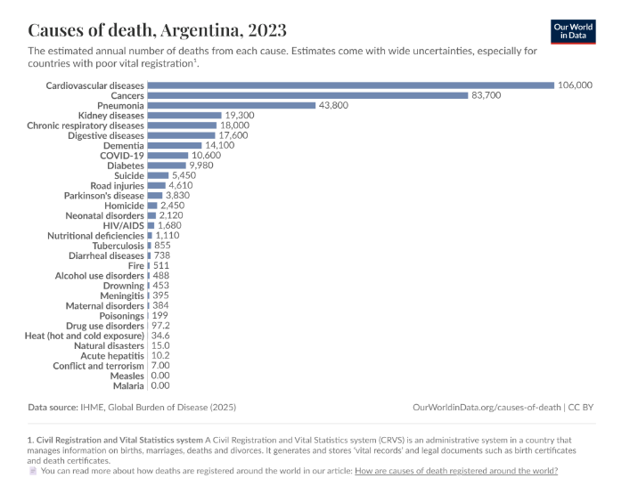
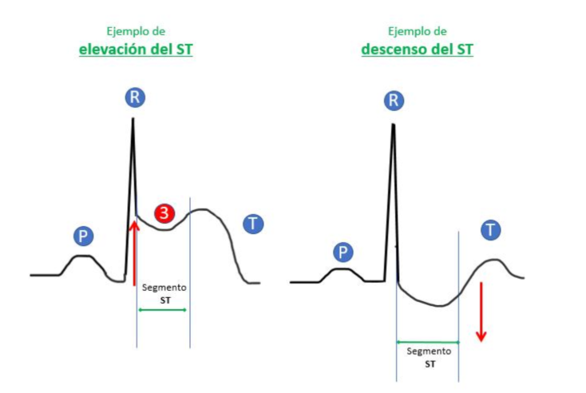

```{r setup, include=FALSE}
knitr::opts_chunk$set(
  echo = TRUE,
  warning = FALSE,
  message = FALSE,
  fig.align = "center",
  fig.width = 7,
  fig.height = 5
)

# -----------------------------------------------------------------
# Paquetes utilizados en el trabajo
# -----------------------------------------------------------------
paquetes <- c(
  "dplyr", "readr", "stringr", "ggplot2", "tableone",
  "broom", "pROC", "ResourceSelection", "pwr",
  "nortest", "car", "epitools", "scales", "knitr"
)

paquetes_faltantes <- paquetes[!(paquetes %in% installed.packages()[, "Package"])]
if (length(paquetes_faltantes) > 0) install.packages(paquetes_faltantes)

invisible(lapply(paquetes, library, character.only = TRUE))

options(knitr.kable.NA = "-")
```

# Introducción

Las enfermedades cardiovasculares constituyen la principal causa de muerte a nivel mundial, representando aproximadamente el 32% de todas las defunciones, lo que equivale a cerca de 19,8 millones de muertes anuales en 2022 según la World Health Organization [1]. Esta elevada carga de morbimortalidad resalta la importancia de identificar factores de riesgo asociados y mejorar las estrategias de detección temprana, especialmente en poblaciones con riesgo cardiovascular.

```{r fig-death-world, echo=FALSE, out.width="85%", fig.cap="Figura 1: Las enfermedades cardiovasculares representan la mayor proporción de muertes a nivel global (19,1 millones), seguidas por cáncer (10,6 millones) y enfermedades crónicas respiratorias (4,15 millones). Estos datos evidencian la alta carga de morbimortalidad asociada a las enfermedades cardiovasculares, consolidándolas como la principal causa de muerte en el mundo [2]."}

```

```{r fig-death-arg, echo=FALSE, out.width="85%", fig.cap="Figura 2: Principales causas de muerte en Argentina durante el año 2023. Al igual que ocurre a nivel mundial, las enfermedades cardiovasculares representaron la principal causa de mortalidad, seguidas por el cáncer y la neumonía [2]."}

```

Dentro de este grupo, la enfermedad cardíaca se asocia a una elevada prevalencia y a un importante impacto en la calidad de vida de los pacientes, así como en los sistemas de salud. En este sentido, la identificación de variables clínicas asociadas a su aparición resulta fundamental para optimizar las estrategias de prevención, diagnóstico y tratamiento. Diversos factores han sido vinculados con el desarrollo de enfermedad cardíaca, incluyendo variables demográficas como la edad y el sexo, parámetros fisiológicos como la presión arterial y los niveles de colesterol, así como indicadores derivados del electrocardiograma (ECG).

Dentro de las herramientas diagnósticas disponibles, el ECG ocupa un lugar central en la evaluación clínica de estos pacientes. En particular, las alteraciones en el segmento ST han demostrado ser marcadores relevantes de isquemia miocárdica y enfermedad coronaria [3]. Diversos estudios han evidenciado que modificaciones en la pendiente del segmento ST (*ST slope*), especialmente aquellas de tipo plano o descendente, se asocian con una mayor probabilidad de enfermedad cardíaca. Esto convierte a esta variable en un indicador clínico de interés para el análisis.

Estas alteraciones se evalúan habitualmente mediante una prueba de esfuerzo (ergometría), durante la cual el paciente es sometido a una carga física creciente mientras se monitorizan parámetros como la frecuencia cardíaca alcanzada, la aparición de angina y los cambios electrocardiográficos del segmento ST, entre ellos su pendiente (**ST_Slope**) y su magnitud de depresión (**Oldpeak**). Estos parámetros constituyen, en conjunto, los componentes clásicos utilizados para la estratificación pronóstica de pacientes evaluados por riesgo cardiovascular.

```{r fig-ejemplo-st, echo=FALSE, out.width="80%", fig.cap="Figura 3: Representación esquemática de la elevación y el descenso del segmento ST en un trazado electrocardiográfico. La elevación del ST se asocia típicamente con isquemia miocárdica transmural o infarto agudo, mientras que el descenso del ST se vincula con isquemia subendocárdica. Estas alteraciones constituyen indicadores clínicos relevantes en la evaluación de la enfermedad cardíaca."}

```

En este contexto, el análisis estadístico de datos clínicos permite explorar la relación entre estas variables y la presencia de enfermedad, contribuyendo a la identificación de factores relevantes. Asimismo, el uso de modelos multivariados, como la regresión logística, posibilita evaluar dichas asociaciones ajustando por posibles variables confusoras, lo que permite obtener estimaciones más precisas.

El presente trabajo se basa en el dataset *Heart Failure Prediction*, disponible en la plataforma Kaggle [4]. Este conjunto de datos contiene información clínica de pacientes evaluados por riesgo cardiovascular, incluyendo variables demográficas, parámetros clínicos y hallazgos electrocardiográficos, lo que permite explorar asociaciones entre distintos factores y la presencia de enfermedad cardíaca.

El objetivo general de este estudio es analizar la relación entre variables clínicas y la presencia de enfermedad cardíaca, con especial énfasis en el rol de la pendiente del segmento ST como posible factor asociado. En particular, se busca evaluar si las alteraciones en dicha variable se relacionan con una mayor probabilidad de presentar enfermedad cardíaca en la población estudiada. Dado que se trata de un estudio observacional basado en datos secundarios, los resultados obtenidos permitirán identificar asociaciones, pero no establecer relaciones causales. No obstante, este enfoque constituye una herramienta valiosa para la generación de hipótesis y el análisis de factores clínicos de interés en el ámbito cardiovascular.

## Planteo de la pregunta PICO

Con el fin de estructurar la pregunta de investigación y orientar el análisis estadístico, se utilizó el modelo PICO (*Population, Intervention/Exposure, Comparison, Outcome*), ampliamente empleado en investigación clínica y epidemiológica para formular preguntas de estudio de manera clara y sistemática.

En el presente trabajo, la población de interés corresponde a pacientes evaluados por riesgo cardiovascular incluidos en el dataset *Heart Failure Prediction*. La exposición analizada fue la presencia de alteraciones en la pendiente del segmento ST (**ST_Slope**), particularmente aquellas clasificadas como planas o descendentes. Como grupo de comparación se consideraron los pacientes con pendiente del ST normal o ascendente. Finalmente, el outcome evaluado fue la presencia de enfermedad cardíaca (**Heart Disease**).

De esta manera, la pregunta de investigación puede formularse de la siguiente manera:

> *"En pacientes evaluados por riesgo cardiovascular, ¿la presencia de alteraciones en la pendiente del segmento ST se asocia con una mayor probabilidad de enfermedad cardíaca en comparación con pacientes con pendiente del ST normal?"*

A partir de esta pregunta se planteó como hipótesis que las alteraciones en la pendiente del segmento ST se encuentran asociadas con una mayor frecuencia de enfermedad cardíaca. Esta hipótesis se fundamenta en la relevancia fisiopatológica de las alteraciones del segmento ST como posibles indicadores de isquemia miocárdica y compromiso cardiovascular.

```{r tabla-pico, echo=FALSE}
tabla_pico_def <- data.frame(
  Componente = c(
    "**P** (Population)",
    "**I/E** (Intervention/Exposure)",
    "**C** (Comparison)",
    "**O** (Outcome)"
  ),
  `Definición en el estudio` = c(
    "Pacientes evaluados por riesgo cardiovascular",
    "ST_Slope anormal (Flat/Down)",
    "ST_Slope normal (Up)",
    "Presencia de enfermedad cardíaca"
  ),
  check.names = FALSE
)

knitr::kable(
  tabla_pico_def,
  caption = "Definición de los componentes de la estrategia PICO utilizados en el estudio."
)
```

# Materiales y métodos

## Diseño del estudio

El presente trabajo corresponde a un estudio observacional, analítico y de corte transversal, basado en el análisis secundario de una base de datos pública. Se considera observacional porque no se realizó ninguna intervención sobre los pacientes ni se manipularon las variables de estudio; la información ya se encontraba previamente registrada. A su vez, se clasifica como analítico porque el objetivo no fue solamente describir la muestra, sino evaluar la asociación entre variables clínicas y electrocardiográficas y la presencia de enfermedad cardíaca. El diseño es transversal debido a que cada individuo fue analizado a partir de un único registro clínico, sin seguimiento temporal ni evaluación de cambios a lo largo del tiempo. Por este motivo, los resultados permiten identificar asociaciones estadísticas entre las variables estudiadas, pero no establecer relaciones causales ni determinar temporalidad entre exposición y desenlace.

## Fuente de datos y base utilizada

Se utilizó el dataset público *Heart Failure Prediction* [4], disponible en la plataforma Kaggle (<https://www.kaggle.com/datasets/fedesoriano/heart-failure-prediction>). Esta base reúne información clínica y electrocardiográfica de pacientes adultos evaluados en el contexto de enfermedad cardiovascular. El conjunto original contiene 918 registros y 12 variables, de las cuales 11 corresponden a características clínicas o electrocardiográficas y una corresponde a la variable respuesta, **HeartDisease**. Se trata de una base secundaria, conformada por la combinación de cinco sub-colecciones hospitalarias independientes (Cleveland, Hungría, Suiza, Long Beach VA y Statlog Heart), por lo que los datos no fueron recolectados específicamente para este trabajo.

**Datos utilizados en este documento:** el archivo `heart.csv` se encuentra incluido junto con este `.Rmd`. En caso de no encontrarse en el directorio de trabajo, el siguiente bloque de código lo descarga automáticamente desde un mirror público de acceso libre (no requiere autenticación), de manera que el documento sea completamente reproducible:

```{r cargar-datos}
ruta_local <- "heart.csv"
url_mirror <- "https://raw.githubusercontent.com/benbobyabraham/heart_failure_prediction_dataset_kaggle/main/heart.csv"

if (!file.exists(ruta_local)) {
  download.file(url_mirror, destfile = ruta_local, mode = "wb")
}

df_raw <- read_csv(ruta_local, show_col_types = FALSE)

cat("Dimensiones originales:", dim(df_raw), "\n")
```

A continuación, se detallan los criterios de inclusión y exclusión utilizados:

- **Criterios de inclusión:** se incluyeron todos los pacientes adultos registrados en el dataset *Heart Failure Prediction*, evaluados clínicamente por sospecha o riesgo de enfermedad cardiovascular, que contaran con registro completo de las variables demográficas, clínicas y electrocardiográficas necesarias para el análisis principal.

- **Criterios de exclusión:** se estableció como criterio de exclusión la presencia de valores fisiológicamente imposibles en las variables clínicas. En consecuencia, se excluyó un (1) registro con un valor de presión arterial en reposo (*RestingBP*) igual a 0 mmHg. No se aplicaron otros criterios de exclusión sobre la muestra principal. Los registros con valores faltantes en *Cholesterol* (n = 171), codificados originalmente como 0, fueron conservados para el análisis principal y excluidos únicamente en el análisis de sensibilidad de dicha variable.

Respecto del marco temporal, el dataset corresponde a una compilación retrospectiva de registros clínicos preexistentes, sin que la plataforma de origen especifique el período exacto de recolección de los datos. Esta falta de información temporal constituye una limitación inherente al uso de bases de datos secundarias, retomada en la sección de Limitaciones.

## Registro y definición de las variables

Se identificó una variable respuesta, correspondiente a la presencia de enfermedad cardíaca, y un conjunto de variables explicatorias de carácter demográfico, clínico y electrocardiográfico potencialmente asociadas con dicho desenlace. La variable de interés principal fue **ST_Slope**, debido a su relevancia clínica como posible marcador de alteraciones de la repolarización ventricular e isquemia miocárdica. Con el objetivo de responder la pregunta de investigación y facilitar la interpretación de los resultados, esta variable fue recodificada en una nueva variable dicotómica denominada **ST_Slope_binary**, agrupando la categoría *Up* como "Normal" y las categorías *Flat* y *Down* como "Anormal".

```{r tabla-variables, echo=FALSE}
tabla_variables <- data.frame(
  Variable = c(
    "Age", "Sex", "ChestPainType", "RestingBP", "Cholesterol", "FastingBS",
    "RestingECG", "MaxHR", "ExerciseAngina", "Oldpeak", "ST_Slope", "HeartDisease"
  ),
  Rol = c(
    "Explicatoria", "Explicatoria", "Explicatoria", "Explicatoria", "Explicatoria",
    "Explicatoria", "Explicatoria", "Explicatoria", "Explicatoria", "Explicatoria",
    "Exposición principal (PICO)", "Respuesta (Outcome)"
  ),
  Tipo = c(
    "Cuantitativa continua", "Categórica nominal (M/F)", "Categórica nominal (TA/ATA/NAP/ASY)",
    "Cuantitativa continua", "Cuantitativa continua", "Categórica binaria",
    "Categórica nominal (Normal/ST/LVH)", "Cuantitativa continua", "Categórica binaria (S/N)",
    "Cuantitativa continua", "Categórica ordinal (Up/Flat/Down)", "Categórica binaria (0/1)"
  ),
  `Unidad / Descripción` = c(
    "Edad del paciente (años)", "Sexo biológico", "Tipo de dolor torácico",
    "Presión arterial en reposo (mmHg)", "Colesterol sérico (mg/dl)",
    "Glucemia en ayunas > 120 mg/dl (1 = Sí, 0 = No)", "Hallazgo del ECG en reposo",
    "Frecuencia cardíaca máxima alcanzada (lpm)", "Angina inducida por ejercicio",
    "Depresión del segmento ST inducida por ejercicio",
    "Pendiente del segmento ST en el pico de ejercicio",
    "Presencia de enfermedad cardíaca (1 = Sí, 0 = No)"
  ),
  check.names = FALSE
)

knitr::kable(tabla_variables, caption = "Variables incluidas en el dataset Heart Failure Prediction.")
```

A los fines del análisis multivariado, las variables explicatorias pueden agruparse conceptualmente en tres categorías según el momento y contexto de su registro: (i) variables demográficas basales (Age, Sex), registradas independientemente de cualquier estudio cardiológico; (ii) variables clínicas y electrocardiográficas de reposo (RestingBP, RestingECG, Cholesterol, FastingBS, ChestPainType); y (iii) variables registradas durante la prueba de esfuerzo (MaxHR, ExerciseAngina, Oldpeak, ST_Slope), que comparten el mismo origen temporal y fisiológico que la exposición principal de este estudio. Esta distinción se retoma en la sección de Análisis multivariado para fundamentar los criterios de selección de covariables del modelo final.


## Procesamiento y acondicionamiento de la base de datos

Durante la etapa de depuración y exploración inicial de la base de datos se realizó una evaluación de la calidad y consistencia de las variables. El dataset original presentó 918 registros y no se identificaron filas duplicadas ni valores faltantes explícitos codificados como NA.

```{r exploracion-inicial}
str(df_raw)

cat("\nCantidad de filas duplicadas:", sum(duplicated(df_raw)), "\n")

cat("\nFrecuencias de variables categóricas:\n")
table(df_raw$Sex)
table(df_raw$ChestPainType)
table(df_raw$RestingECG)
table(df_raw$ExerciseAngina)
table(df_raw$ST_Slope)
table(df_raw$HeartDisease)
```

Sin embargo, al analizar los rangos de las variables numéricas mediante estadística descriptiva, se observaron valores mínimos iguales a cero en las variables **RestingBP** y **Cholesterol**, fisiológicamente imposibles.

```{r valores-imposibles}
n_total <- nrow(df_raw)
n_bp0 <- sum(df_raw$RestingBP == 0, na.rm = TRUE)
n_chol0 <- sum(df_raw$Cholesterol == 0, na.rm = TRUE)

cat("Registros con RestingBP = 0:", n_bp0,
    "(", round(100 * n_bp0 / n_total, 2), "% )\n")
cat("Registros con Cholesterol = 0:", n_chol0,
    "(", round(100 * n_chol0 / n_total, 2), "% )\n")

cat("\nDistribución de HeartDisease entre quienes tienen Cholesterol = 0:\n")
table(df_raw$HeartDisease[df_raw$Cholesterol == 0])
```

Para **RestingBP**, dado que se identificó un único registro afectado (aproximadamente el 0,1% de la muestra), se decidió excluirlo del análisis sin impacto significativo sobre el tamaño muestral. Para **Cholesterol**, dado que 172 registros (18,7%) presentaron valor igual a cero —y que la mayoría de estos casos correspondía a pacientes con enfermedad cardíaca, lo cual sugiere un mecanismo de tipo *missing not at random*— se descartaron tanto la opción de conservar los ceros como la de imputar por media/mediana, y se optó por recodificar estos valores como `NA`, conservando la variable para los análisis descriptivos y de sensibilidad, pero excluyéndola del modelo multivariado principal.

```{r depuracion}
df_clean <- df_raw %>%
  filter(RestingBP != 0) %>%
  mutate(Cholesterol = ifelse(Cholesterol == 0, NA, Cholesterol))

df_clean <- df_clean %>%
  mutate(
    Age = as.numeric(Age),
    RestingBP = as.numeric(RestingBP),
    Cholesterol = as.numeric(Cholesterol),
    MaxHR = as.numeric(MaxHR),
    Oldpeak = as.numeric(Oldpeak),
    Sex = factor(Sex),
    ChestPainType = factor(ChestPainType),
    RestingECG = factor(RestingECG),
    ExerciseAngina = factor(ExerciseAngina),
    ST_Slope = factor(ST_Slope, levels = c("Up", "Flat", "Down")),
    FastingBS = factor(FastingBS, levels = c(0, 1), labels = c("No", "Si")),
    HeartDisease = factor(HeartDisease, levels = c(0, 1), labels = c("No", "Si")),
    ST_Slope_binary = case_when(
      ST_Slope == "Up" ~ "Normal",
      ST_Slope %in% c("Flat", "Down") ~ "Anormal",
      TRUE ~ NA_character_
    ),
    ST_Slope_binary = factor(ST_Slope_binary, levels = c("Normal", "Anormal")),
    HeartDisease_num = ifelse(HeartDisease == "Si", 1, 0)
  )

cat("Dimensiones finales:", dim(df_clean), "\n")

cat("\nNA por columna luego de la depuración:\n")
colSums(is.na(df_clean))

cat("\nDistribución final de ST_Slope_binary:\n")
table(df_clean$ST_Slope_binary)
```

Finalmente, dado que el dataset es resultado de la consolidación de cinco sub-colecciones hospitalarias independientes, la muestra está sujeta a diferentes prácticas de derivación y criterios de *screening* clínico de cada centro (riesgo de **sesgo de selección**). Para mitigar la influencia de variables confusoras asociadas a este muestreo no probabilístico, el análisis multivariado posterior incluyó de forma simultánea covariables demográficas (*Age, Sex*) y clínicas basales esenciales (*ExerciseAngina, MaxHR, Oldpeak*), con el objetivo de estimar el efecto neto de la pendiente del segmento ST (*ST_Slope_binary*) sobre la presencia de enfermedad cardíaca.

A partir de este punto, se utiliza el objeto `df` con las variables ya tipadas, en línea con el código original de análisis:

```{r df-final}
df <- df_clean
vars_cont <- c("Age", "RestingBP", "Cholesterol", "MaxHR", "Oldpeak")
vars_cat <- c("Sex", "ChestPainType", "FastingBS", "RestingECG",
              "ExerciseAngina", "ST_Slope", "ST_Slope_binary")
```

## Evaluación de normalidad

La distribución de las variables cuantitativas continuas fue evaluada mediante métodos gráficos (histogramas y QQ-plots) y tres pruebas estadísticas de normalidad: Shapiro-Wilk, Lilliefors (Kolmogorov-Smirnov con corrección para parámetros estimados de la muestra) y Anderson-Darling, con $\alpha=0,05$. Debido al tamaño muestral relativamente elevado del estudio ($n=917$), los resultados de las pruebas de normalidad no fueron interpretados de forma aislada, sino en conjunto con la evidencia gráfica; dado que en muestras grandes, pequeñas desviaciones pueden producir valores de $p$ significativos, aun cuando tengan escasa relevancia práctica.

## Tamaño muestral y poder estadístico

Dado que se trabajó con una base de datos secundaria, el tamaño muestral no fue definido a priori. Se realizó una evaluación retrospectiva del tamaño muestral ideal y del poder estadístico utilizando la comparación principal planteada en la pregunta PICO (**ST_Slope_binary** vs. **HeartDisease**), mediante comparación de proporciones, con $\alpha=0,05$ y un poder deseado del 80%. Estos cálculos deben interpretarse como estimaciones orientativas y no como un diseño prospectivo previo a la recolección de datos.

## Análisis descriptivo

Las variables categóricas fueron resumidas mediante frecuencias absolutas y porcentajes. Para las variables cuantitativas se calcularon medidas de tendencia central y dispersión (media y desvío estándar, o mediana y rango intercuartílico según los resultados de la evaluación de normalidad).

## Análisis univariado

Para las variables categóricas se utilizó la prueba de chi-cuadrado de independencia (o el test exacto de Fisher cuando las frecuencias esperadas fueron menores a 5). Las variables cuantitativas se compararon mediante la prueba $t$ de Welch (variables aproximadamente normales) o la prueba de Mann-Whitney (variables no normales). Para la variable principal **ST_Slope_binary**, se construyeron tablas de contingencia y se estimó el Odds Ratio (OR) crudo con su intervalo de confianza del 95%.

## Análisis multivariado

Se ajustaron modelos de regresión logística binaria utilizando **HeartDisease** como variable respuesta. Se planteó un modelo teórico saturado con todas las variables explicatorias disponibles (excluyendo **Cholesterol** por los motivos descritos previamente) y, a partir de éste, un modelo final reducido focalizado en **ST_Slope_binary** y en covariables seleccionadas *a priori* por relevancia clínica (**Age, Sex, ExerciseAngina, MaxHR, Oldpeak**). Esta selección combinó dos criterios complementarios: por un lado, la inclusión de confusores demográficos clásicos (edad, sexo), cuya relación con la exposición y el desenlace es independiente y bien establecida en la literatura epidemiológica; por otro, la inclusión de covariables registradas durante la misma prueba de esfuerzo (angina inducida por ejercicio, frecuencia cardíaca máxima y depresión del ST (Oldpeak)), que constituyen, junto con la pendiente del segmento ST, los componentes clásicos de scores pronósticos de prueba de esfuerzo como el Duke Treadmill Score [5]. Se optó por un criterio conservador de ajuste, asumiendo que el riesgo de un eventual sobreajuste por la inclusión de covariables relacionadas con la misma prueba resulta preferible a dejar confusión residual sin controlar.

Se evaluó la multicolinealidad mediante el *Variance Inflation Factor* (VIF, valores < 5 indican ausencia de colinealidad relevante), la calibración mediante el test de Hosmer-Lemeshow, y la capacidad discriminativa mediante curvas ROC y AUC. Se exploró además la presencia de modificadores de efecto mediante términos de interacción entre **ST_Slope_binary** y variables clínicamente relevantes (edad, sexo, angina inducida por ejercicio), evaluados mediante pruebas de razón de verosimilitud ($p<0,05$).

## Software estadístico

Todos los análisis estadísticos fueron realizados utilizando el software R [6] (R Foundation for Statistical Computing, Viena, Austria), con funciones de los paquetes *dplyr*, *readr* y *stringr* (meta-paquete *tidyverse*) [7] para la manipulación de datos, *car* para el cálculo de VIF [8], *pROC* para curvas ROC y AUC [9], y *ResourceSelection* para la prueba de Hosmer-Lemeshow [10]. En todos los análisis se adoptó un nivel de significancia estadística de $\alpha=0,05$.

# Resultados

## Evaluación de normalidad

```{r normalidad, fig.height=4}
resultados_normalidad <- data.frame()

for (v in vars_cont) {
  x <- na.omit(df[[v]])

  par(mfrow = c(1, 2))

  if (v == "RestingBP") {
    # RestingBP fue registrada con fuerte redondeo clinico: ~74% de los valores
    # son multiplos de 5 y los multiplos de 10 concentran picos muy marcados
    # (p.ej. n=132 en 120, n=118 en 130, n=107 en 140). Con breaks=20 generico,
    # los bordes de bin caen justo sobre esos valores y generan un artefacto de
    # aliasing tipo "peine" (barras alternadamente altas y bajas). Se usan bins
    # de ancho 10 centrados en los multiplos de 10 (bordes en ...+5) para que
    # cada pico de redondeo quede contenido dentro de un unico bin.
    breaks_v <- seq(floor(min(x) / 10) * 10 - 5, ceiling(max(x) / 10) * 10 + 5, by = 10)
    hist(x, breaks = breaks_v, main = paste("Histograma de", v), xlab = v,
         col = "lightblue", border = "white")
  } else {
    hist(x, breaks = 20, main = paste("Histograma de", v), xlab = v,
         col = "lightblue", border = "white")
  }
  # box() asegura que el marco del grafico encierre todo el rango de barras:
  # por defecto, axis() solo dibuja la linea entre la primera y la ultima marca
  # "linda" que elige R, que rara vez coincide con los extremos reales de los
  # datos, dejando el eje mas corto/desplazado respecto de las barras.
  box()

  qqnorm(x, main = paste("QQ-plot de", v))
  qqline(x, col = "red", lwd = 2)
  par(mfrow = c(1, 1))

  shapiro_res <- if (length(x) >= 3 && length(x) <= 5000) shapiro.test(x) else NULL
  lillie_res <- nortest::lillie.test(x)
  ad_res <- nortest::ad.test(x)

  resultados_normalidad <- rbind(
    resultados_normalidad,
    data.frame(
      Variable = v,
      Shapiro_p = if (!is.null(shapiro_res)) signif(shapiro_res$p.value, 3) else NA,
      Lilliefors_p = signif(lillie_res$p.value, 3),
      AndersonDarling_p = signif(ad_res$p.value, 3)
    )
  )
}

knitr::kable(
  resultados_normalidad,
  caption = "Resultados de las pruebas de normalidad para las variables cuantitativas continuas."
)
```

Las cinco variables analizadas (**Age, RestingBP, Cholesterol, MaxHR** y **Oldpeak**) presentaron valores de $p$ inferiores a 0,05 en las tres pruebas estadísticas aplicadas, lo que indica evidencia de desviación respecto de una distribución normal. No obstante, debido al tamaño muestral elevado del estudio, estos resultados se interpretaron conjuntamente con la inspección visual de histogramas y QQ-plots. Las variables **Age** y **MaxHR** mostraron distribuciones aproximadamente simétricas y una buena alineación con la recta teórica en los gráficos QQ. Por el contrario, **RestingBP** presentó una ligera asimetría hacia valores elevados, **Cholesterol** mostró una cola derecha más pronunciada, y **Oldpeak** fue la variable con mayor alejamiento de la normalidad, con una marcada concentración de observaciones cercanas a cero y una asimetría positiva importante.

En conjunto, **Age, RestingBP** y **MaxHR** fueron comparadas entre grupos mediante el test $t$ de Welch (robusto ante desviaciones moderadas dado el tamaño muestral elevado, en virtud del Teorema Central del Límite), mientras que **Cholesterol** y **Oldpeak**, con desviaciones más marcadas, fueron comparadas mediante el test no paramétrico de Mann-Whitney.

## Tamaño muestral y poder estadístico

```{r tamano-muestral}
tab_pico <- table(df$ST_Slope_binary, df$HeartDisease)
tab_pico

p_normal <- tab_pico["Normal", "Si"] / sum(tab_pico["Normal", ])
p_anormal <- tab_pico["Anormal", "Si"] / sum(tab_pico["Anormal", ])

cat("Proporción de enfermedad en ST normal:", round(p_normal, 3), "\n")
cat("Proporción de enfermedad en ST anormal:", round(p_anormal, 3), "\n")

cat("\nTamaño muestral ideal para 80% de poder:\n")
power.prop.test(
  p1 = p_normal, p2 = p_anormal,
  power = 0.80, sig.level = 0.05, alternative = "two.sided"
)

cat("\nPoder estadístico aproximado de la muestra utilizada:\n")
power.prop.test(
  n = min(sum(tab_pico["Normal", ]), sum(tab_pico["Anormal", ])),
  p1 = p_normal, p2 = p_anormal,
  sig.level = 0.05, alternative = "two.sided"
)
```

La proporción de enfermedad cardíaca fue marcadamente mayor en el grupo con pendiente anormal del ST (82,2%) que en el grupo normal (19,7%). A partir de estas proporciones, el tamaño muestral ideal para detectar una diferencia de esta magnitud con 80% de poder resultó muy inferior al tamaño muestral efectivamente disponible (9 < 917 pacientes), lo que se traduce en un poder estadístico estimado cercano al 100% para la muestra utilizada. Cabe señalar que se trata de un cálculo *post-hoc*, realizado sobre el mismo efecto observado, por lo que debe interpretarse como una estimación orientativa y no como una validación independiente.

## Características de la muestra

```{r tabla1, results="asis"}
tabla1 <- CreateTableOne(
  vars = c(vars_cont, vars_cat),
  strata = "HeartDisease",
  data = df,
  factorVars = vars_cat
)

print(tabla1, showAllLevels = TRUE, quote = FALSE, noSpaces = TRUE, test = FALSE, printToggle = FALSE) %>%
  knitr::kable(caption = "Características demográficas y clínicas de la muestra, estratificadas por presencia de enfermedad cardíaca (n = 917).")
```

El análisis se realizó sobre una muestra final de 917 pacientes, de los cuales 507 (55,3%) presentaban enfermedad cardíaca y 410 (44,7%) no presentaban enfermedad. La distribución de la variable respuesta fue relativamente equilibrada entre ambas categorías, lo que favorece el ajuste e interpretación de los modelos de regresión logística. En comparación con este último grupo, los pacientes con enfermedad cardíaca fueron, en promedio, de mayor edad y presentaron valores más elevados de presión arterial en reposo, colesterol sérico y depresión del segmento ST (**Oldpeak**), mientras que la frecuencia cardíaca máxima fue menor. Asimismo, en el grupo con enfermedad predominaron el sexo masculino, el dolor torácico de tipo asintomático (**ASY**), la presencia de angina inducida por ejercicio, la glucemia elevada en ayunas y una pendiente anormal del segmento ST. 


## Análisis univariado

### Variables categóricas

```{r univariado-cat}
resultados_chi <- data.frame()

for (v in vars_cat) {
  tab <- table(df[[v]], df$HeartDisease)
  test_chi <- chisq.test(tab)

  fisher_p <- NA
  if (any(test_chi$expected < 5) && all(dim(tab) == c(2, 2))) {
    fisher_p <- fisher.test(tab)$p.value
  }

  resultados_chi <- rbind(
    resultados_chi,
    data.frame(
      Variable = v,
      Chi2 = round(test_chi$statistic, 2),
      gl = test_chi$parameter,
      p_chi2 = signif(test_chi$p.value, 3),
      p_fisher = if (!is.na(fisher_p)) signif(fisher_p, 3) else NA
    )
  )
}

knitr::kable(
  resultados_chi,
  caption = "Asociación entre las variables categóricas y la presencia de enfermedad cardíaca (test de chi-cuadrado de Pearson; test exacto de Fisher cuando correspondió)."
)
```

En el análisis univariado, todas las variables categóricas mostraron una asociación estadísticamente significativa (p < 0,05) con la presencia de enfermedad cardíaca, de acuerdo con la prueba de chi-cuadrado de Pearson o el test exacto de Fisher según correspondiera. 

### Variables cuantitativas

```{r univariado-cont}
vars_normales <- c("Age", "RestingBP", "MaxHR")
vars_no_normales <- c("Cholesterol", "Oldpeak")

resultados_cont <- data.frame()

for (v in vars_cont) {
  x_no <- df %>% filter(HeartDisease == "No") %>% pull(v) %>% na.omit()
  x_si <- df %>% filter(HeartDisease == "Si") %>% pull(v) %>% na.omit()

  if (v %in% vars_normales) {
    test_res <- t.test(x_no, x_si)
    test_usado <- "t de Welch"
  } else {
    test_res <- wilcox.test(x_no, x_si, exact = FALSE)
    test_usado <- "Mann-Whitney"
  }

  resultados_cont <- rbind(
    resultados_cont,
    data.frame(
      Variable = v,
      Test = test_usado,
      `Media/Mediana (No)` = round(ifelse(v %in% vars_normales, mean(x_no), median(x_no)), 2),
      `Media/Mediana (Si)` = round(ifelse(v %in% vars_normales, mean(x_si), median(x_si)), 2),
      p_valor = signif(test_res$p.value, 3),
      check.names = FALSE
    )
  )
}

knitr::kable(
  resultados_cont,
  caption = "Comparación de las variables cuantitativas entre pacientes con y sin enfermedad cardíaca."
)
```

Todas las variables cuantitativas mostraron diferencias estadísticamente significativas entre los pacientes con y sin enfermedad cardíaca (p < 0,05). Las comparaciones se realizaron mediante la prueba t de Welch o la prueba de Mann-Whitney, según correspondiera 

## Asociación entre la pendiente del segmento ST y la presencia de enfermedad cardíaca

```{r pico-analisis}
tab_pico <- table(df$ST_Slope_binary, df$HeartDisease)
tab_pico

cat("\nPorcentajes por fila:\n")
round(prop.table(tab_pico, margin = 1) * 100, 2)

cat("\nTest Chi-cuadrado:\n")
chisq.test(tab_pico)

cat("\nOdds Ratio crudo:\n")
epitools::oddsratio(tab_pico)
```

La distribución de los pacientes según **ST_Slope_binary** mostró diferencias marcadas entre ambos grupos. Entre los pacientes con pendiente del ST normal, el 80,25% no presentó enfermedad cardíaca, mientras que entre los pacientes con pendiente anormal, el 82,18% presentó enfermedad cardíaca. El análisis mediante chi-cuadrado mostró una asociación altamente significativa ($p<0,001$). El Odds Ratio crudo obtenido fue de 18,64 (IC95%: 13,41-26,19), indicando que los pacientes con pendiente del ST anormal presentaron aproximadamente 18 veces mayores odds de enfermedad cardíaca que aquellos con pendiente normal. 
Estos hallazgos sugieren que la alteración de la pendiente del segmento ST constituye uno de los factores más fuertemente asociados con la presencia de enfermedad cardíaca dentro de la población estudiada, resultado compatible con la hipótesis planteada.

## Análisis multivariado

### Modelo crudo PICO

```{r modelo-crudo}
modelo_crudo <- glm(HeartDisease ~ ST_Slope_binary, data = df, family = binomial)
broom::tidy(modelo_crudo, exponentiate = TRUE, conf.int = TRUE)
```

Nótese que el OR aquí obtenido mediante regresión logística (18,75) es consistente con, aunque ligeramente distinto al estimado por tabla de contingencia en la sección 3.5 (18,64), debido a las diferencias entre los métodos de estimación.

Las métricas de desempeño (AUC, AIC, Pseudo-R²) y la comparación de calibración de este modelo se presentan más adelante junto con los modelos saturado y final (secciones 3.6.5 y 3.7), para facilitar la comparación conjunta. No se calculó el test de Hosmer-Lemeshow dado que, con una única covariable binaria, el modelo predice solamente dos valores de probabilidad posibles, lo que vuelve poco informativo un test de calibración basado en deciles de riesgo.


### Modelo teórico saturado (sin Colesterol)

```{r modelo-saturado}
modelo_saturado <- glm(
  HeartDisease ~ ST_Slope + Age + Sex + ChestPainType + RestingBP +
    FastingBS + RestingECG + MaxHR + ExerciseAngina + Oldpeak,
  data = df, family = binomial
)

summary(modelo_saturado)
broom::tidy(modelo_saturado, exponentiate = TRUE, conf.int = TRUE)
```


```{r modelo-saturado-eval, fig.height=5, fig.width=5}
cat("--- VIF MODELO SATURADO ---\n")
car::vif(modelo_saturado)

prob_saturado <- predict(modelo_saturado, type = "response")
hoslem_saturado <- ResourceSelection::hoslem.test(modelo_saturado$y, prob_saturado, g = 10)
cat("\n--- HOSMER-LEMESHOW MODELO SATURADO ---\n")
hoslem_saturado

roc_saturado <- pROC::roc(modelo_saturado$y, prob_saturado, quiet = TRUE)
cat("\n--- AUC MODELO SATURADO ---\n")
pROC::auc(roc_saturado)

plot(roc_saturado, col = "darkgreen", lwd = 3, main = "Curva ROC - Modelo saturado")
abline(a = 0, b = 1, lty = 2, col = "gray")

modelo_nulo <- glm(HeartDisease ~ 1, data = modelo_saturado$model, family = binomial)
pseudo_r2_saturado <- as.numeric(1 - (logLik(modelo_saturado) / logLik(modelo_nulo)))
cat("\nPseudo R2 de McFadden (modelo saturado):", round(pseudo_r2_saturado, 3), "\n")
cat("AIC modelo saturado:", round(AIC(modelo_saturado), 2), "\n")
```

El modelo saturado incluyó la totalidad de las variables explicatorias disponibles, a excepción de **Cholesterol**. Todos los valores de VIF resultaron inferiores a 5, sin evidencia de multicolinealidad relevante. El test de Hosmer-Lemeshow no mostró evidencia de falta de ajuste, indicando una adecuada calibración, y el modelo alcanzó una elevada capacidad discriminativa (AUC > 0,9).

### Evaluación de confusión (construcción incremental del modelo PICO)

```{r confusion}
extraer_or_st <- function(modelo) {
  broom::tidy(modelo, exponentiate = TRUE, conf.int = TRUE) %>%
    filter(term == "ST_Slope_binaryAnormal") %>%
    select(term, estimate, conf.low, conf.high, p.value)
}

modelo_pico_0 <- glm(HeartDisease ~ ST_Slope_binary, data = df, family = binomial)
modelo_pico_1 <- glm(HeartDisease ~ ST_Slope_binary + Age, data = df, family = binomial)
modelo_pico_2 <- glm(HeartDisease ~ ST_Slope_binary + Age + Sex, data = df, family = binomial)
modelo_pico_3 <- glm(HeartDisease ~ ST_Slope_binary + Age + Sex + ExerciseAngina, data = df, family = binomial)
modelo_pico_4 <- glm(HeartDisease ~ ST_Slope_binary + Age + Sex + ExerciseAngina + MaxHR + Oldpeak, data = df, family = binomial)

tabla_confusion <- bind_rows(
  extraer_or_st(modelo_pico_0) %>% mutate(Modelo = "Crudo"),
  extraer_or_st(modelo_pico_1) %>% mutate(Modelo = "+ Edad"),
  extraer_or_st(modelo_pico_2) %>% mutate(Modelo = "+ Edad + Sexo"),
  extraer_or_st(modelo_pico_3) %>% mutate(Modelo = "+ Edad + Sexo + Angina"),
  extraer_or_st(modelo_pico_4) %>% mutate(Modelo = "+ Edad + Sexo + Angina + MaxHR + Oldpeak")
) %>%
  select(Modelo, OR = estimate, IC95_inf = conf.low, IC95_sup = conf.high, p_value = p.value)

knitr::kable(tabla_confusion, digits = 3,
             caption = "Evolución del Odds Ratio de ST_Slope_binary al incorporar covariables de forma incremental (evaluación de confusión).")
```

Con el objetivo de evaluar el efecto de las covariables sobre la asociación entre **ST_Slope_binary** y la presencia de enfermedad cardíaca, se construyeron modelos de regresión logística incorporando progresivamente variables clínicamente relevantes. El OR de **ST_Slope_binary** disminuyó desde 18,75 en el modelo crudo hasta 9,25 en el modelo ajustado final, evidenciando una atenuación de la magnitud de la asociación tras el ajuste por posibles variables confusoras. La mayor reducción del OR se observó al incorporar la variable ExerciseAngina. No obstante, ST_Slope_binary mantuvo una asociación estadísticamente significativa con la enfermedad cardíaca en todos los modelos evaluados


### Modelo final reducido

```{r modelo-final}
modelo_final <- glm(
  HeartDisease ~ ST_Slope_binary + Age + Sex + ExerciseAngina + MaxHR + Oldpeak,
  data = df, family = binomial
)

summary(modelo_final)

resultado_final <- broom::tidy(modelo_final, exponentiate = TRUE, conf.int = TRUE)
knitr::kable(resultado_final, digits = 3,
             caption = "Resultados del modelo de regresión logística multivariado final (Odds Ratios ajustados).")
```

```{r modelo-final-eval, fig.height=5, fig.width=5}
cat("--- VIF MODELO FINAL ---\n")
car::vif(modelo_final)

prob_final <- predict(modelo_final, type = "response")
hoslem_final <- ResourceSelection::hoslem.test(modelo_final$y, prob_final, g = 10)
cat("\n--- HOSMER-LEMESHOW MODELO FINAL ---\n")
hoslem_final

roc_final <- pROC::roc(modelo_final$y, prob_final, quiet = TRUE)
cat("\n--- AUC MODELO FINAL ---\n")
pROC::auc(roc_final)

plot(roc_final, col = "purple", lwd = 3, main = "Curva ROC - Modelo final")
abline(a = 0, b = 1, lty = 2, col = "gray")

modelo_nulo_final <- glm(HeartDisease ~ 1, data = modelo_final$model, family = binomial)
pseudo_r2_final <- as.numeric(1 - (logLik(modelo_final) / logLik(modelo_nulo_final)))
cat("\nPseudo R2 de McFadden (modelo final):", round(pseudo_r2_final, 3), "\n")
cat("AIC modelo final:", round(AIC(modelo_final), 2), "\n")
```

En el modelo final, todas las variables incluidas mostraron asociación estadísticamente significativa con la presencia de enfermedad cardíaca. La variable con mayor magnitud de asociación fue **ST_Slope_binary**: los pacientes con pendiente anormal del ST presentaron un OR ajustado de aproximadamente 9 (IC95% aproximado 6,2-13,9; $p<0,001$) en comparación con aquellos con pendiente normal, aun luego de ajustar por edad, sexo, angina inducida por ejercicio, frecuencia cardíaca máxima y Oldpeak. El sexo masculino, la angina inducida por ejercicio, Oldpeak y la edad mostraron asociaciones positivas, mientras que MaxHR mostró una asociación inversa. Todos los valores de VIF fueron inferiores a 5, sin evidencia de multicolinealidad relevante, y el test de Hosmer-Lemeshow no mostró evidencia de falta de ajuste en ninguno de los dos modelos, lo que indica una adecuada calibración. Si bien el modelo saturado presentó un AIC sustancialmente menor (mejor ajuste global) y un AUC levemente superior, se reportó el modelo reducido como modelo principal por motivos de parsimonia e interpretabilidad clínica, dado que el foco del estudio es la asociación de **ST_Slope_binary** con la enfermedad cardíaca.

Cabe destacar que ChestPainType y FastingBS, si bien mostraron asociaciones significativas en el modelo saturado, no fueron incluidas en el modelo final. Esta decisión respondió a que ambas variables son marcadores diagnósticos de otra naturaleza (tipo de dolor torácico referido y control glucémico), ajenos tanto a los confusores demográficos clásicos como a los hallazgos de la prueba de esfuerzo en estudio, por lo que su inclusión excede el alcance de la pregunta PICO planteada. Estas variables permanecen incorporadas en el modelo saturado, utilizado como referencia exploratoria de desempeño global.

### Comparación de curvas ROC: modelo crudo, saturado y final

```{r roc-comparacion, fig.height=5.5, fig.width=5.5}
roc_crudo <- pROC::roc(modelo_crudo$y, predict(modelo_crudo, type = "response"), quiet = TRUE)

plot(roc_crudo, col = "black", lwd = 3, main = "Comparación de curvas ROC")
plot(roc_saturado, col = "darkgreen", lwd = 3, add = TRUE)
plot(roc_final, col = "purple", lwd = 3, add = TRUE)
abline(a = 0, b = 1, lty = 2, col = "gray")
legend(
  "bottomright",
  legend = c(
    paste0("Crudo (AUC = ", round(as.numeric(pROC::auc(roc_crudo)), 3), ")"),
    paste0("Saturado (AUC = ", round(as.numeric(pROC::auc(roc_saturado)), 3), ")"),
    paste0("Final (AUC = ", round(as.numeric(pROC::auc(roc_final)), 3), ")")
  ),
  col = c("black", "darkgreen", "purple"), lwd = 3, bty = "n"
)
```

Ambos modelos ajustados (saturado y final) superan ampliamente al modelo crudo basado únicamente en **ST_Slope_binary**, evidenciando el aporte de las covariables adicionales a la capacidad predictiva global.

### Análisis de sensibilidad incorporando Colesterol

```{r sensibilidad-colesterol, fig.height=5.5, fig.width=5.5}
df_col <- df %>% filter(!is.na(Cholesterol))
cat("Registros con colesterol disponible:", nrow(df_col), "de", nrow(df), "\n")

modelo_saturado_sin_col_dfcol <- glm(
  HeartDisease ~ ST_Slope + Age + Sex + ChestPainType + RestingBP +
    FastingBS + RestingECG + MaxHR + ExerciseAngina + Oldpeak,
  data = df_col, family = binomial
)

modelo_saturado_con_col <- glm(
  HeartDisease ~ ST_Slope + Age + Sex + ChestPainType + RestingBP + Cholesterol +
    FastingBS + RestingECG + MaxHR + ExerciseAngina + Oldpeak,
  data = df_col, family = binomial
)

cat("\n--- COMPARACIÓN MODELOS CON Y SIN COLESTEROL (misma submuestra) ---\n")
anova(modelo_saturado_sin_col_dfcol, modelo_saturado_con_col, test = "Chisq")

roc_sin_col <- pROC::roc(modelo_saturado_sin_col_dfcol$y,
                          predict(modelo_saturado_sin_col_dfcol, type = "response"), quiet = TRUE)
roc_con_col <- pROC::roc(modelo_saturado_con_col$y,
                          predict(modelo_saturado_con_col, type = "response"), quiet = TRUE)

cat("\nAUC sin colesterol (submuestra):", round(as.numeric(pROC::auc(roc_sin_col)), 3), "\n")
cat("AUC con colesterol:", round(as.numeric(pROC::auc(roc_con_col)), 3), "\n")

plot(roc_sin_col, col = "steelblue", lwd = 3, main = "Comparación ROC - Sensibilidad con colesterol")
plot(roc_con_col, col = "darkorange", lwd = 3, add = TRUE)
abline(a = 0, b = 1, lty = 2, col = "gray")
legend(
  "bottomright",
  legend = c(
    paste0("Sin colesterol (AUC = ", round(as.numeric(pROC::auc(roc_sin_col)), 3), ")"),
    paste0("Con colesterol (AUC = ", round(as.numeric(pROC::auc(roc_con_col)), 3), ")")
  ),
  col = c("steelblue", "darkorange"), lwd = 3, bty = "n"
)
```

La incorporación de **Cholesterol** en el subconjunto de pacientes con datos disponibles produjo una mejora mínima en el desempeño discriminativo del modelo. Sin embargo, su inclusión implicó una reducción considerable del tamaño muestral efectivo. Considerando el patrón no aleatorio de los datos faltantes en esta variable, se mantuvo como modelo principal aquel que no incluyó colesterol.

### Modificación de efecto: interacciones con sexo, edad y angina

```{r interacciones-st-slope}
modelo_base_interaccion <- modelo_final

modelo_int_sex <- glm(
  HeartDisease ~ ST_Slope_binary * Sex + Age + ExerciseAngina + MaxHR + Oldpeak,
  data = df,
  family = binomial
)
cat("--- Interacción ST_Slope_binary x Sex ---\n")
anova(modelo_base_interaccion, modelo_int_sex, test = "Chisq")

modelo_int_age <- glm(
  HeartDisease ~ ST_Slope_binary * Age + Sex + ExerciseAngina + MaxHR + Oldpeak,
  data = df, family = binomial
)
cat("--- Interacción ST_Slope_binary x Age ---\n")
anova(modelo_base_interaccion, modelo_int_age, test = "Chisq")

modelo_int_angina <- glm(
  HeartDisease ~ ST_Slope_binary * ExerciseAngina + Age + Sex + MaxHR + Oldpeak,
  data = df, family = binomial
)
cat("\n--- Interacción ST_Slope_binary x ExerciseAngina ---\n")
anova(modelo_base_interaccion, modelo_int_angina, test = "Chisq")
```
No se observaron interacciones estadísticamente significativas entre **ST_Slope_binary** y **Sex**, ni entre **ST_Slope_binary** y **ExerciseAngina** inducida por ejercicio. En cambio, se identificó una interacción nominalmente significativa entre **ST_Slope_binary** y **Age** (p = 0,034), lo que sugiere que la magnitud de la asociación entre la pendiente del segmento ST y la enfermedad cardíaca podría variar según la edad del paciente.

No obstante, dado que se evaluaron tres interacciones de forma exploratoria sin corrección por comparaciones múltiples, este resultado debe interpretarse con cautela. Aplicando una corrección conservadora de Bonferroni para tres comparaciones, el umbral de significación sería aproximadamente $p<0,017$, por lo que la interacción con edad no alcanzaría significación bajo este criterio. Por este motivo, y para preservar la interpretabilidad clínica del modelo, se decidió mantener el modelo principal sin términos de interacción.


## Desempeño del modelo

```{r desempeno-resumen, echo=FALSE}
resumen_modelos <- data.frame(
  Modelo = c("Crudo (solo ST_Slope_binary)", "Saturado", "Final reducido"),
  AIC = round(c(AIC(modelo_crudo), AIC(modelo_saturado), AIC(modelo_final)), 2),
  AUC = round(c(as.numeric(pROC::auc(roc_crudo)),
                as.numeric(pROC::auc(roc_saturado)),
                as.numeric(pROC::auc(roc_final))), 3),
  `Pseudo_R2_McFadden` = round(c(
    as.numeric(1 - logLik(modelo_crudo) / logLik(glm(HeartDisease ~ 1, data = modelo_crudo$model, family = binomial))),
    pseudo_r2_saturado,
    pseudo_r2_final
  ), 3),
  check.names = FALSE
)
knitr::kable(resumen_modelos, caption = "Comparación resumida de los modelos ajustados.")
```

El modelo final reducido alcanzó una elevada capacidad discriminativa, con un área bajo la curva ROC cercana a 0,90, lo que indica una excelente capacidad para diferenciar pacientes con y sin enfermedad cardíaca. El pseudo-R² de McFadden obtenido refleja una mejora sustancial en la capacidad explicativa respecto del modelo nulo, resultado coherente con la magnitud de las asociaciones identificadas, particularmente para la pendiente del segmento ST.

# Discusión

## Interpretación de los principales hallazgos

El objetivo de este estudio fue evaluar la asociación entre la pendiente del segmento ST y la presencia de enfermedad cardíaca en una población de pacientes adultos evaluados por riesgo cardiovascular. Los resultados obtenidos mostraron una asociación fuerte y estadísticamente significativa entre ambas variables, tanto en el análisis univariado como luego del ajuste por variables demográficas y clínicas relevantes mediante regresión logística.

La magnitud de la asociación observada fue particularmente elevada. El Odds Ratio crudo indicó que los pacientes con una pendiente anormal del segmento ST presentaban aproximadamente 18 veces mayores odds de enfermedad cardíaca en comparación con aquellos con una pendiente normal. Tras ajustar por edad, sexo, frecuencia cardíaca máxima, angina inducida por ejercicio y depresión del segmento ST inducida por ejercicio, la asociación disminuyó pero permaneció altamente significativa, con un Odds Ratio ajustado superior a 9. Esta reducción era esperable, ya que parte de la asociación observada inicialmente puede atribuirse a la influencia de variables clínicas relacionadas tanto con la pendiente del ST como con la enfermedad cardíaca. Sin embargo, el hecho de que la asociación persistiera después del ajuste refuerza la relevancia clínica de esta variable como marcador cardiovascular.

Estos hallazgos resultan consistentes con el conocimiento fisiopatológico actual [11]. Las alteraciones del segmento ST reflejan modificaciones en los procesos de despolarización y repolarización ventricular y suelen asociarse con fenómenos de isquemia miocárdica o enfermedad coronaria. Por este motivo, resulta esperable que pacientes con patrones anormales del ST presenten una mayor prevalencia de enfermedad cardíaca.

## Otras variables asociadas con la presencia de enfermedad cardíaca

Además de la pendiente del segmento ST, el análisis multivariado identificó otras variables clínicamente relevantes asociadas con la presencia de enfermedad cardíaca: el sexo masculino, la presencia de angina inducida por ejercicio, la edad, la frecuencia cardíaca máxima alcanzada y la depresión del segmento ST inducida por ejercicio (**Oldpeak**).

El sexo masculino mostró una de las asociaciones más importantes observadas en el modelo, con aproximadamente cinco veces mayores odds de enfermedad cardíaca respecto de las mujeres, aun después de controlar por otros factores. Este hallazgo es consistente con la evidencia epidemiológica disponible [12]. La presencia de angina inducida por ejercicio también mostró una fuerte asociación, esperable dado que el dolor torácico durante la actividad física constituye un indicador clásico de insuficiencia coronaria. La edad presentó una asociación positiva de menor magnitud, coincidente con el conocimiento actual sobre el riesgo cardiovascular asociado al envejecimiento vascular [13]. **Oldpeak** mostró una asociación positiva e independiente, coherente con su utilización clínica como marcador de isquemia miocárdica durante pruebas de esfuerzo. Finalmente, **MaxHR** mostró una asociación inversa: los pacientes capaces de alcanzar frecuencias cardíacas máximas más elevadas tendieron a presentar menor probabilidad de enfermedad. Esta asociación admite una explicación fisiológica estándar: la frecuencia cardíaca máxima alcanzable disminuye naturalmente con la edad y puede verse reducida por el uso de fármacos betabloqueantes —variable no registrada en esta base de datos—, ambos factores más frecuentes en pacientes con mayor carga de enfermedad cardiovascular. No puede descartarse, adicionalmente, que refleje alteraciones funcionales o estructurales subyacentes del sistema cardiovascular, aunque esta interpretación debe tomarse con cautela dado el carácter observacional del estudio.

Cabe señalar que ExerciseAngina, MaxHR y Oldpeak no son confusores independientes en el sentido clásico, sino covariables obtenidas durante la misma prueba de esfuerzo que ST_Slope, por lo que su relación con la exposición principal admite cierta ambigüedad causal: podrían actuar como verdaderos confusores (reflejando una capacidad funcional o un estado cardiovascular general subyacente) o, alternativamente, como co-manifestaciones de un mismo evento isquémico. Dado que distinguir entre ambos escenarios excede el alcance de este trabajo, se optó por un ajuste conservador, lo que implica que el OR ajustado de ST_Slope_binary podría representar una estimación conservadora (por defecto) del efecto total de esta variable.

El análisis exploratorio de interacciones sugirió una posible modificación de efecto por edad en la asociación entre la pendiente del segmento ST y la enfermedad cardíaca (hallazgo no significativo tras la corrección por comparaciones múltiples). Sin embargo, debido al carácter secundario de este análisis y a la magnitud limitada del efecto observado, estos resultados deben interpretarse con cautela y ser confirmados en futuros estudios.

## Comparación con la literatura

Los resultados obtenidos son consistentes con la evidencia disponible sobre los factores asociados a la enfermedad cardiovascular. La fuerte asociación observada entre las alteraciones de la pendiente del segmento ST y la presencia de enfermedad cardíaca coincide con el papel que tradicionalmente se atribuye a los cambios del segmento ST como indicadores de isquemia miocárdica y alteraciones de la perfusión coronaria [14]. Asimismo, las asociaciones identificadas para edad, sexo masculino y angina inducida por ejercicio concuerdan con el conocimiento epidemiológico actual. El elevado desempeño predictivo del modelo multivariado (AUC ≈ 0,90) respalda la utilidad de integrar información clínica y electrocardiográfica para la identificación de pacientes con enfermedad cardíaca.

## Limitaciones del estudio

Los resultados de este trabajo deben interpretarse considerando algunas limitaciones inherentes al diseño y a las características de la base de datos utilizada. En primer lugar, se trata de un estudio observacional de corte transversal basado en datos secundarios, por lo que las asociaciones identificadas no permiten establecer relaciones causales ni determinar la secuencia temporal entre las variables explicatorias y la presencia de enfermedad cardíaca.

En segundo lugar, la información analizada provino de una base de datos pública previamente recolectada, por lo que los procedimientos de medición, los criterios diagnósticos y la calidad de los registros no pudieron ser verificados directamente por los investigadores. Una limitación particular fue la presencia de valores fisiológicamente imposibles en la variable **Cholesterol** (registrados como cero), recodificados como datos faltantes, cuya distribución no fue completamente aleatoria respecto del desenlace (mecanismo de tipo *missing not at random*), lo que dificultó su incorporación en el modelo multivariado principal.

Asimismo, no puede descartarse la presencia de factores de confusión residuales asociados a variables no registradas en la base de datos, como antecedentes familiares, tabaquismo, hipertensión arterial diagnosticada o medicación utilizada. Desde el punto de vista de los sesgos metodológicos, el estudio podría verse afectado por un posible sesgo de información asociado al manejo de los datos faltantes en Colesterol, y por un posible sesgo de selección propio de la fuente original de los datos, dado que se desconocen los criterios exactos bajo los cuales los pacientes fueron incluidos en cada una de las cinco sub-colecciones que componen el dataset.

Por último, la población incluida en el dataset no necesariamente representa a la totalidad de los pacientes con enfermedad cardiovascular ni a la población general, por lo que la extrapolación de los resultados a otros contextos clínicos debe realizarse con precaución.

## Fortalezas del estudio

A pesar de las limitaciones mencionadas, el presente estudio presenta varias fortalezas. La base de datos analizada contó con un tamaño muestral elevado (917 pacientes), lo que proporcionó una adecuada potencia estadística. La disponibilidad de múltiples variables demográficas, clínicas y electrocardiográficas relevantes permitió realizar un análisis integral del problema, evaluando tanto asociaciones simples como modelos multivariados. Se realizó además un proceso sistemático de depuración y control de calidad de los datos, identificando registros inconsistentes y evaluando explícitamente el impacto de los datos faltantes, así como una evaluación de normalidad mediante métodos gráficos y pruebas estadísticas que permitió seleccionar procedimientos inferenciales apropiados. Finalmente, el elevado valor de AUC obtenido refuerza la consistencia interna de los resultados.

# Conclusiones

El presente estudio evaluó la asociación entre la pendiente del segmento ST y la presencia de enfermedad cardíaca en una población de pacientes adultos utilizando una base de datos pública de riesgo cardiovascular. Las alteraciones en la pendiente del segmento ST se asociaron fuertemente con la presencia de enfermedad cardíaca tanto en el análisis univariado (OR crudo = 18,64) como luego del ajuste por variables demográficas y clínicas relevantes (OR ajustado > 9), resultados compatibles con la hipótesis planteada al inicio del trabajo y que destacan la relevancia clínica de esta variable electrocardiográfica.

Otras variables —sexo masculino, edad, angina inducida por ejercicio, frecuencia cardíaca máxima alcanzada y depresión del segmento ST inducida por ejercicio— mostraron asociaciones independientes con la presencia de enfermedad cardíaca, y el modelo multivariado desarrollado presentó una elevada capacidad discriminativa (AUC ≈ 0,90).

Debido a la naturaleza observacional y transversal del estudio, estos hallazgos deben interpretarse como asociaciones estadísticas y no como relaciones causales. No obstante, desde una perspectiva aplicada, sugieren que la pendiente del segmento ST podría incorporarse —junto con otras variables clínicas de fácil obtención— como un criterio adicional de estratificación de riesgo o de derivación a una evaluación cardiológica más profunda en pacientes con sospecha de enfermedad coronaria, en línea con su uso ya establecido en scores pronósticos de prueba de esfuerzo como el Duke Treadmill Score.

# Bibliografía {-}

[1] World Health Organization, "Cardiovascular diseases (CVDs)," WHO, Jun. 11, 2021. [Online]. Available: <https://www.who.int/news-room/fact-sheets/detail/cardiovascular-diseases-(cvds)>.

[2] Our World in Data, "Annual number of deaths by cause," Our World in Data. [Online]. Available: <https://ourworldindata.org/grapher/annual-number-of-deaths-by-cause>.

[3] R. Gianrossi et al., "Exercise-induced ST depression in the diagnosis of coronary artery disease. A meta-analysis.," *Circulation*, vol. 80, no. 1, pp. 87-98, Jul. 1989, doi: 10.1161/01.cir.80.1.87.

[4] fedesoriano, "Heart Failure Prediction Dataset," Kaggle, sep. 2021. [Online]. Available: <https://www.kaggle.com/datasets/fedesoriano/heart-failure-prediction>.

[5] Mark DB, Shaw L, Harrell FE Jr, et al. Prognostic Value of a Treadmill Exercise Score in Outpatients with Suspected Coronary Artery Disease. N Engl J Med. 1991;325:849–853. Available: <https://www.nejm.org/doi/full/10.1056/NEJM199109193251204>

[6] R Core Team, "R: A Language and Environment for Statistical Computing," *R Foundation for Statistical Computing*, Vienna, Austria, 2026. [Online]. Available: <https://www.R-project.org/>

[7] H. Wickham et al., "Welcome to the Tidyverse," *Journal of Open Source Software*, vol. 4, no. 43, p. 1686, Nov. 2019, doi: 10.21105/joss.01686.

[8] J. Fox and S. Weisberg, *An R Companion to Applied Regression*, 3rd ed. Thousand Oaks, CA, USA: Sage, 2019.

[9] X. Robin et al., "pROC: an open-source package for R and S+ to analyze and compare ROC curves," *BMC Bioinformatics*, vol. 12, no. 1, p. 77, Mar. 2011, doi: 10.1186/1471-2105-12-77.

[10] S. Lele, J. L. Keim, and S. R. Solymos, "ResourceSelection: Resource Selection Functions using Likelihood Methods," *R package version 0.3-6*, 2023. [Online]. Available: <https://CRAN.R-project.org/package=ResourceSelection>

[11] Lim YC, Teo SG. ST-segment changes with exercise stress. Singapore Medical Journal. 2016. Available: <https://pmc.ncbi.nlm.nih.gov/articles/PMC4958709/>

[12] Pérez-López FR, et al. Gender Differences in Cardiovascular Disease: Hormonal and Biochemical Influences. Rev Endocr Metab Disord. 2010. Available: <https://pmc.ncbi.nlm.nih.gov/articles/PMC3107852/>

[13] Arterial and cardiac aging: major shareholders in cardiovascular disease enterprises: Part I: aging arteries: a "set up" for vascular disease. Available: <https://pubmed.ncbi.nlm.nih.gov/12515756/>

[14] K. Thygesen et al., "Fourth universal definition of myocardial infarction," *Journal of the American College of Cardiology*, vol. 72, no. 18, pp. 2231-2264, Oct. 2018, doi: 10.1016/j.jacc.2018.08.1038.
